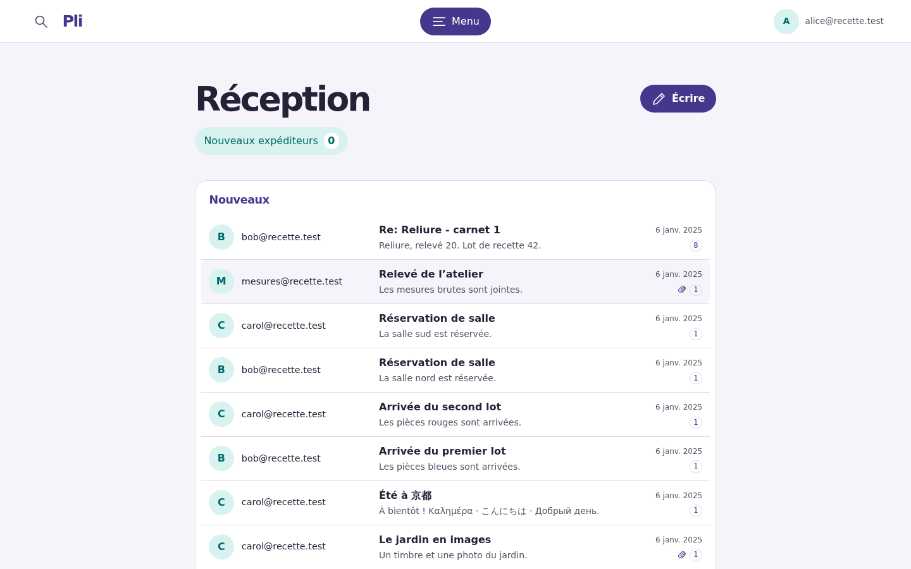

# Pli — le webmail réinventé

Un proche attend votre réponse. Votre lettre préférée peut attendre dimanche. Ce reçu vous sera surtout utile dans six mois.

Pli vous laisse choisir où retrouver chacun de ces courriers. La première fois qu’un expéditeur vous écrit, vous voyez son nom, son adresse et un extrait avant de décider où ranger ses messages.

| Vue | Ce que vous y gardez |
| --- | --- |
| **Réception** | Les conversations que vous voulez suivre de près. |
| **Flux** | Les lettres et les nouvelles à parcourir quand vous en avez le temps. |
| **Justificatifs** | Les reçus et les confirmations à retrouver le moment venu. |

Votre choix s’applique aussi aux futurs messages de cette adresse. Vous pouvez refuser un expéditeur ou changer sa destination depuis l’historique du tri. Ses anciens courriers suivent le nouveau choix.



## Reprendre là où vous en étiez

Quittez la Réception pour consulter un dossier, puis revenez. La liste déjà chargée s’affiche à la même position, sur le même fil, pendant que les nouveautés arrivent en arrière-plan. Au clavier, **H** ouvre le menu et **Échap** le referme.

## Essayer Pli

Depuis la racine du projet, lancez l’interface de développement et ouvrez [Pli sur votre machine](http://127.0.0.1:5173).

```sh
make dev
```

Le guide détaille les prérequis, la configuration d’une boîte et les commandes de vérification. Vous pouvez aussi découvrir Pli avec une boîte de démonstration remplie de messages fictifs. [Guide technique](docs/guide-technique.md) · [Boîte de démonstration](bench/README.md)
